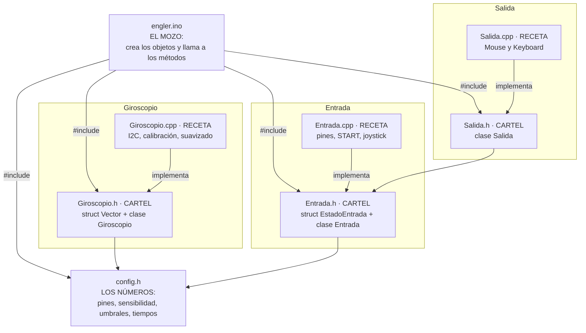
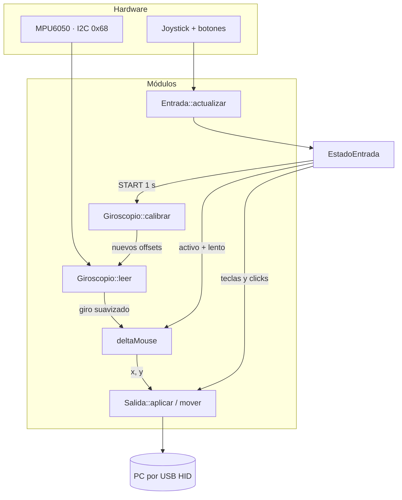

# R1c2

[](https://gitdiagram.com/doro098/r1c2?utm_source=readme&utm_medium=badge)

Repositorio entrega cuenta 2.

Trabajo de **Engler Lisandro Francisco** (`lichaengler`). El sketch original se
recuperó del [issue #1](https://github.com/lichaengler/R1c2/issues/1) del
repositorio del alumno: el código estaba publicado como texto en el issue, no
como archivo. Es el mismo código, separado en módulos para poder analizarlo en
clase.

**Placa:** Arduino Leonardo (USB HID nativo: se presenta ante la PC como mouse y
teclado).

---

## Qué hace

Convierte una pistola de juguete en un control de PC:

- mover la pistola → mover el mouse;
- joystick → `W A S D`, click del joystick → `Shift`;
- RB → click izquierdo, LB → click derecho y mira más lenta;
- Y → `R` (recargar), B → `C` (agacharse);
- START: toque corto = activar/pausar; mantener 1 segundo = recalibrar.

---

## Hardware

| Elemento | Conexión | Uso |
|---|---|---|
| MPU6050 | I2C `0x68`, 100 kHz | Giroscopio: ejes Y (vertical) y Z (horizontal) |
| RB | pin D5 | Click izquierdo |
| LB | pin D9 | Click derecho + mira lenta |
| Y | pin D8 | Tecla `R` |
| B | pin D7 | Tecla `C` |
| START | pin D6 | Activar/pausar / recalibrar |
| Click del joystick | pin A1 | `Shift` |
| Joystick X | pin A3 | Adelante/atrás (`W`/`S`) |
| Joystick Y | pin A2 | Derecha/izquierda (`D`/`A`) |

Todos los botones usan `INPUT_PULLUP`: **apretado = `LOW`**.

---

## Arquitectura: archivo por archivo

El badge de arriba muestra una vista generada por gitdiagram a partir del árbol
de archivos. Este diagrama complementa esa vista con la relación real entre
archivos: quién incluye a quién y dónde está cada responsabilidad.



| Archivo | Papel | Qué contiene |
|---|---|---|
| `config.h` | Los números | Pines, sensibilidad, deadzone, umbral, tiempos y registros del MPU. No tiene `.cpp`: no hay nada que implementar. |
| `Giroscopio.h` | 📋 Cartel | `struct Vector` (`x`, `y`) y la clase con `begin()`, `calibrar()`, `leer()`, `deltaMouse()`. |
| `Giroscopio.cpp` | 🍳 Receta | I2C, promedio de 100 lecturas, filtro suavizado, deadzone y acumulador de decimales. |
| `Entrada.h` | 📋 Cartel | `struct EstadoEntrada` (10 datos) y la clase `Entrada`. |
| `Entrada.cpp` | 🍳 Receta | `pinMode`, máquina de estados de START, lectura del joystick y de botones. |
| `Salida.h` | 📋 Cartel | Clase `Salida` y los `bool` de estado anterior de cada tecla/click. |
| `Salida.cpp` | 🍳 Receta | `Mouse.move()`, `Keyboard.press()/release()`; avisa sólo cuando algo cambia. |
| `engler.ino` | El mozo | Crea `Giroscopio giro;`, `Entrada entrada;`, `Salida salida;` y escribe el flujo. |

---

## Cómo se organiza un módulo: `.h` y `.cpp`

En C++ se separa **qué se puede usar** de **cómo se hace**.

- El **`.h`** es el **cartel**: anuncia que algo existe, con su nombre, parámetros
  y tipo de retorno. No tiene el cuerpo de las funciones.
- El **`.cpp`** es la **receta**: tiene el cuerpo de esas funciones. Se compila
  una sola vez, aparte.

`#include "Giroscopio.h"` significa literalmente *"pegá acá el contenido de ese
archivo antes de seguir"*. Por eso `engler.ino` sabe que `giro.leer()` existe
sin necesidad de leer la receta.

Ejemplo real, el método `leer()`:

**Cartel (`Giroscopio.h`):**
```cpp
bool leer();     // existe, devuelve true/false
```

**Receta (`Giroscopio.cpp`):**
```cpp
bool Giroscopio::leer() {
  int h, v;
  if (!leerCrudo(h, v)) return false;
  giroH_ = giroH_ * (1 - SUAVIZADO) + (h - offH_) * SUAVIZADO;
  giroV_ = giroV_ * (1 - SUAVIZADO) + (v - offV_) * SUAVIZADO;
  return true;
}
```

**Uso (`engler.ino`):**
```cpp
#include "Giroscopio.h"
...
giro.leer();     // el compilador ya sabe que existe
```

Al final, el compilador junta las dos piezas. Si el cuerpo estuviera en el `.h`,
se copiaría en cada archivo que lo incluye y aparecería el error *"definida dos
veces"*. Por eso conviene separar.

**Regla rápida:**

| Querés… | Tocás… |
|---|---|
| Cambiar el suavizado | `Giroscopio.cpp` |
| Cambiar la sensibilidad | `config.h` |
| Agregar un método nuevo | prototipo en `.h` + cuerpo en `.cpp` |
| Saber qué hace un módulo sin leer los detalles | el `.h` |

---

## Flujo de ejecución



1. **`entrada.actualizar()`** devuelve un `EstadoEntrada` con todo lo que pasó en
   la vuelta: activo, recalibrar, lenta, joystick y botones.
2. **START** tiene dos significados según el tiempo: toque corto (más de 30 ms
   para ignorar rebote) = activar/pausar; 1 segundo apretado = recalibrar.
3. **`giro.leer()`** aplica el filtro `giro = giro * 0.7 + (lectura - offset) * 0.3`.
   Eso quita el temblor de la mano.
4. **`deltaMouse()`** descarta giros menores a la zona muerta (250), aplica la
   sensibilidad (`0.002`, la mitad con LB) y guarda los decimales sobrantes en
   `restoX_`/`restoY_` para la vuelta siguiente. Así un movimiento lento no se
   pierde, aunque `Mouse.move()` sólo acepta enteros.
5. **`salida.aplicar()`** traduce todo a HID, y sólo envía `press`/`release`
   cuando el estado cambia (no cada 5 ms).
6. **`delay(5)`** al final: unas 200 vueltas por segundo.

---

## Parámetros (`config.h`)

| Constante | Valor | Qué controla |
|---|---|---|
| `SENS` | `0.002` | Velocidad de la mira; con LB se reduce a la mitad |
| `ZONA_MUERTA` | `250` | Giros menores se ignoran |
| `UMBRAL` | `200` | Cuánto empujar el joystick para caminar |
| `SUAVIZADO` | `0.3` | Cuánto del giro nuevo se mezcla en cada vuelta |
| `START_MS` | `1000` | START mantenido = recalibrar |
| `DEBOUNCE_MS` | `30` | Rebote del botón START |
| `LOOP_MS` | `5` | Retardo al final de cada vuelta |
| `MUESTRAS_CAL` | `100` | Lecturas para promediar el "cero" del sensor |

---

## Compilar y probar

1. Abrir `engler.ino` en el IDE de Arduino (1.8 o 2.x).
2. Seleccionar placa **Arduino Leonardo** y el puerto correspondiente.
3. Compilar y cargar.
4. Probar con la pistola apoyada: START mantener 1 segundo para calibrar;
   después START corto para activar.

La validación hecha hasta ahora fue estructural (includes y nombres): en el
entorno donde se modularizó no había compilador ni `arduino-cli`.

---

## Origen

- Código original: https://github.com/lichaengler/R1c2/issues/1
- Fork: https://github.com/doro098/R1c2
- Diagrama generado: https://gitdiagram.com/doro098/r1c2
- Commits: `2e22342` (sketch recuperado) · `7cd13e6` (modularización) ·
  `783c8a8` (badge).
